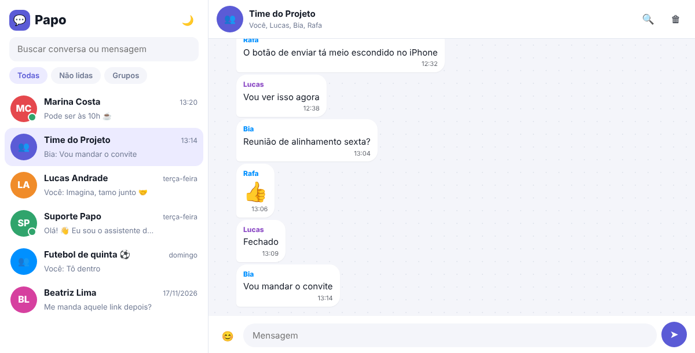

# ChatMock — Interface de chat

Protótipo de aplicativo de mensagens ("Papo") com conversas, respostas automáticas, reações, busca e tema escuro.

🔗 **[Ver o site no ar](https://iamviniciuslima05.github.io/PROJETO-ChatMock/)**



## Funcionalidades

- Lista de **conversas e grupos** com prévia, horário e não lidas
- **Respostas automáticas** com indicador de "digitando…" e um **assistente** que responde comandos
- **Tiques** de enviada, entregue e lida
- **Responder** citando, **reagir** com emoji e apagar mensagem (com desfazer)
- **Emojis**, mensagens só de emoji em tamanho grande
- **Busca** em todas as conversas e dentro de uma conversa
- **Tema escuro** e layout de celular com navegação entre telas
- Tudo salvo no navegador

## Tecnologias

HTML5 · CSS3 · JavaScript · localStorage

## Estrutura

```
index.html
css/style.css
js/script.js
```

## Como rodar

Não precisa instalar nada: baixe o projeto e abra o `index.html` no navegador, ou acesse a versão publicada acima.

---
Feito por **Vinicius Lima** · [Portfólio](https://viniciuslimadev.netlify.app) · [LinkedIn](https://www.linkedin.com/in/viniciuslima25/)
